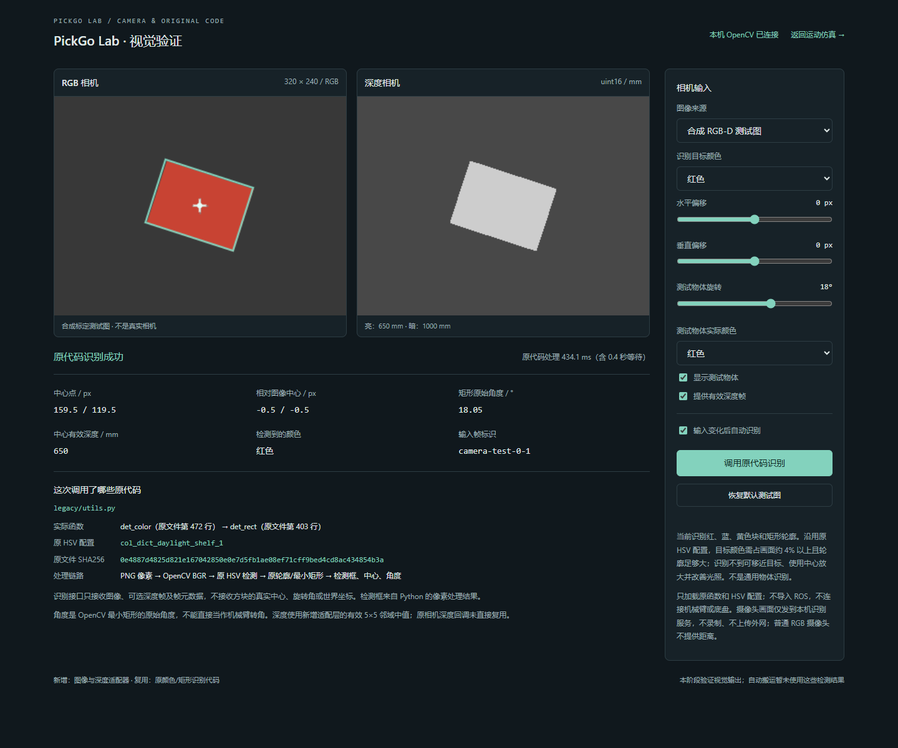
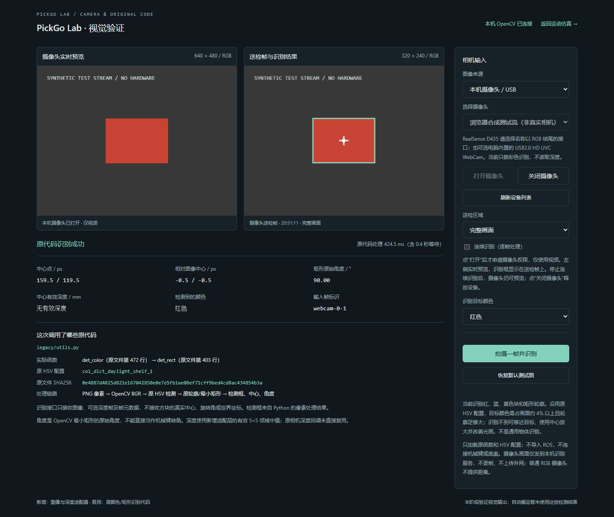
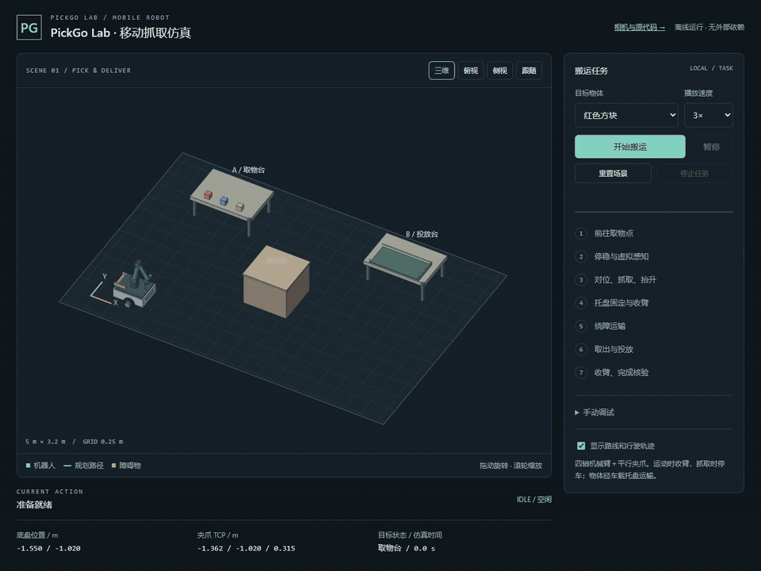
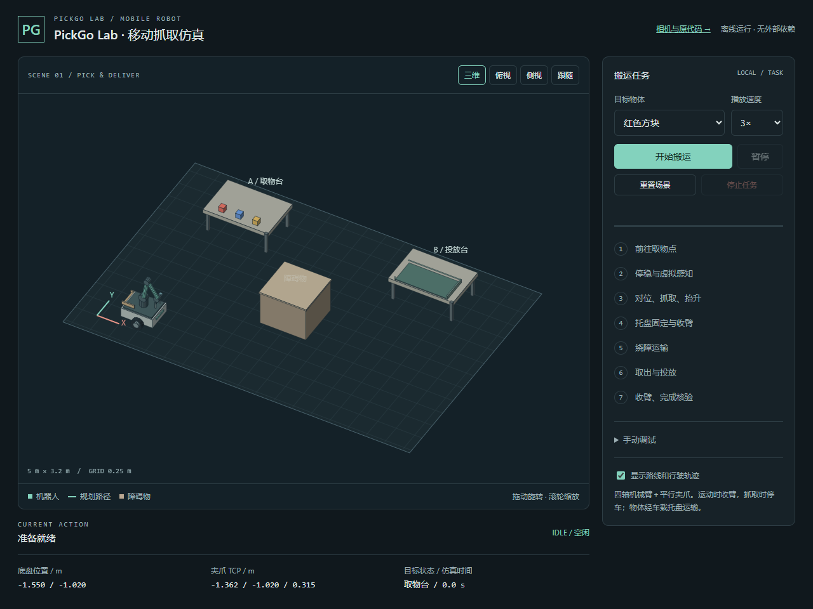
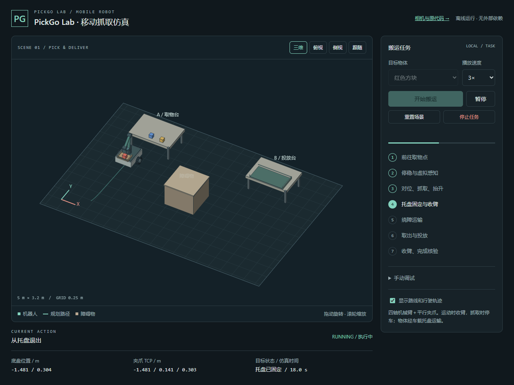
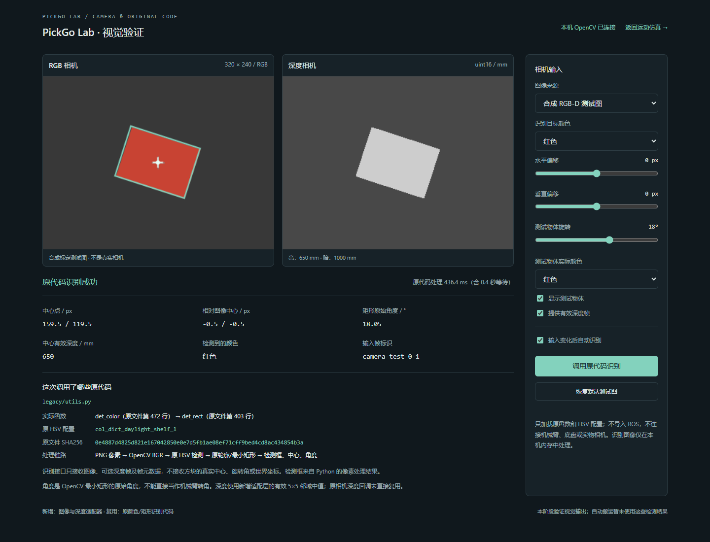

# PickGo Lab

v0.3.0 · 2026-10-18

PickGo Lab 是一个轻量的底盘＋机械臂运动学仿真项目，同时提供复用原机器人代码的相机识别验证工具。

运动仿真可单文件离线运行；本机服务模式让网页、Python 动作函数和 MCP 共用一个机器人场景。视觉验证执行原 `det_color`、`det_rect` 和 HSV 配置。

项目仓库：[williamtymhuabian/pickgo-lab](https://github.com/williamtymhuabian/pickgo-lab)。

## 演示与截图

### v0.3.0：RGB 输入与送检帧

下面两张是本轮页面联调截图。合成 RGB-D 图用于检查原视觉函数；视频输入使用浏览器合成测试流，画面标有 `SYNTHETIC TEST STREAM / NO HARDWARE`，没有打开真实摄像头，也不能据此判断 D435 的实物识别效果。





### 离线运动演示

以下素材来自项目实际运行，展示运动学仿真与独立视觉验证；不连接真实机器人，视觉检测尚未接入自动搬运闭环。

### 完整搬运动画

红色方块从取物台出发，经过机械臂抓取、托盘固定、底盘绕障运输与投放，最终完成收臂和结果核验。录制时使用页面的 3× 播放速度，结尾任务状态为 `SUCCEEDED`。



[查看或下载清晰版 MP4（1280 × 960，约 19 秒）](docs/media/pick-and-deliver.mp4)

<details>
<summary>展开查看三维场景、托盘运输与视觉检测截图</summary>

### 三维仿真界面

取物台、投放台、障碍物与移动机械臂同场展示，右侧提供任务控制，底部显示实时位置与任务状态。



### 托盘固定与运输准备

红色方块已固定在车载托盘上，机械臂从托盘退出，接着收臂并沿规划路径运输。



### 原代码视觉验证

使用合成 RGB-D 测试图调用原 Python 识别函数，显示实际检测框、中心、角度与有效深度。截图中的检测耗时仅代表本次运行。



</details>

## 快速开始

### 只看运动仿真

用现代浏览器打开 `index.html`，不需要安装依赖。选择方块后点击“开始搬运”，即可演示抓取、托盘固定、绕障运输和投放。支持手动调姿、暂停、继续、停止和状态导出。

### 网页与 MCP 共用仿真

需要 Python 3.10+ 和 Node.js 18+，无 npm 依赖：

```bash
python -B app.py
```

打开 <http://127.0.0.1:8767/>。网页右上角显示“共享仿真 · MCP 可连接”。双击 `start.cmd` 也可启动。

MCP 客户端以 stdio 启动 `mcp_server.py` 即可；默认连接上面的本机服务，不会另建场景。配置示例见 [mcp.example.json](mcp.example.json)，把 Python 和脚本路径改为你电脑上的路径。详见 [MCP 接入说明](docs/mcp.md)。当前支持经典 MCP 协议的 stdio/tools 子集，不需要安装 MCP SDK。

可用工具：`get_capabilities`、`get_robot_state`、`grab_and_send`、`pause_task`、`resume_task`、`stop_task`、`reset_scene`、`det_color`。启动任务立即返回 `task_id`，随后查询状态；共享模式下网页关闭或 MCP 客户端退出，已接收任务仍由 `app.py` 执行。

### 可选：运行原代码视觉验证

在仓库目录运行：

```bash
python -m pip install -r requirements.txt
python -B app.py
```

已有依赖时可直接启动。未安装视觉依赖时，共享运动仿真和 MCP 动作工具照常可用，视觉工具会明确报告不可用。

打开：

- 运动仿真：<http://127.0.0.1:8767/>
- 视觉验证：<http://127.0.0.1:8767/vision.html>

服务仅监听本机，图像只在内存中处理；Ctrl+C 关闭。默认端口占用时可用 `python -B app.py --port 8768`，并改用对应端口访问。

视觉页面支持合成 RGB-D 测试图、位置与角度变化、颜色匹配、本地 RGB 图片、无目标和无效深度测试。输出检测框、中心、像素偏差、原始矩形角度与有效深度。

### 接入内置 / USB 摄像头进行 RGB 识别

```bash
python -B app.py --vision-only
```

Windows 可双击 `start-camera.cmd`。打开 <http://127.0.0.1:8767/vision.html?source=camera>，选择摄像头、点击“打开摄像头”，允许浏览器访问相机。支持单帧和连续颜色识别；此模式不需要 Node.js，不启动仿真进程。

已在本机设备列表中确认 RealSense D435 的 RGB 和 Depth 两个接口。**当前选择名称以 RGB 结尾的接口**，或电脑内置的 USB2.0 HD UVC WebCam；已知的 Depth / IR 接口会在列表中禁选。这里只使用彩色画面，深度相机的测距与配准暂缓，不需要安装 RealSense / OpenNI SDK。

检测框对应实际送检帧，实时预览独立显示；中心坐标以 320×240 送检图像为准。连续识别逐帧等待返回，不积压请求。可选择中心放大提高目标占比。原算法包含 0.4 秒等待、颜色占比和轮廓尺寸门槛，当前不是通用物体检测。

只访问视频，不申请麦克风，不录制或保存摄像头图片。切换来源、关闭摄像头或退出页面会释放设备。若内嵌浏览器无法授权，请在本机 Edge / Chrome 打开同一地址。详细排查见 [摄像头说明](docs/camera.md)。

## 目录

```text
index.html                 单文件三维运动仿真
vision.html                相机输入与原代码识别验证
simulator-core.js          独立运动学、寻路和任务状态机
simulator-worker.cjs        网页与 MCP 共享的仿真进程
Constants.py               APP / ROBOT / GRAB 配置字典
utils.py                   业务函数及工具名称映射
robot.py                   底层仿真通信函数
app.py                     本机网页与 HTTP 接口
mcp_server.py              MCP stdio 入口
mcp.example.json           客户端配置示例
legacy_vision.py           原识别函数加载与图像/深度适配
camera.js                  本机视频采集、设备选择、中心裁剪与资源释放
start-camera.cmd           仅启动摄像头识别（不需要 Node.js）
start.cmd                  Windows 启动脚本
requirements.txt           可选视觉功能依赖
legacy/
  utils.py                 用户提供的原模块，逐字节保留
  source-manifest.json     原文件来源与 SHA256
tests/                     运动仿真与视觉接口测试
docs/
  usage.md                 详细操作说明
  architecture.md          后续通用机器人平台设计草案
  mcp.md                   MCP 接入、函数入口与协议边界
  camera.md                RGB 摄像头操作、实测记录与排查
  roadmap.md               创新方向与后续实现路线
  github.md                现有仓库更新说明
  blog/README.md           v0.3.0 项目实践说明
experiments/
  reachability-probe.cjs    固定停车位的可达性探测
CHANGELOG.md               更新记录
NOTICE.md                  原代码来源与许可说明
examples/pick_and_send.py   按步骤调用业务函数的示例
```

克隆后的运行与测试不依赖仓库外的原始工程。原生 SDK、ROS 工程、历史备份、录制数据和大型二进制不包含在这个轻量仓库中。

## 代码来源与当前能力

新编写：浏览器渲染、简化四轴机械臂与差速底盘模型、正逆运动学、底盘 A* 寻路、任务状态机、界面、视觉适配与本机服务。

控制代码沿用原项目的组织习惯：`Constants.py` 放字典配置，`utils.py` 放 `all_init`、`grab_and_send` 等动作函数，按工具名称查字典后调用明确的函数。`robot.py` 隔离通信，`app.py` 和 `mcp_server.py` 共用这些入口。底层数学核心保留独立状态对象，HTTP 处理器使用标准库要求的类；不会为了外观一致修改已验证的原算法。

复用：`legacy/utils.py` 中的 `det_color`、`det_rect` 和 `col_dict_daylight_shelf_1`。只按 AST 白名单加载所需定义，不导入整个原模块，不触发 ROS、串口或机器人初始化。页面显示原文件 SHA256 与函数行号；测试校验原文件内容未变。原始文件的来源与归属沿用源项目，没有给原始代码或厂家 SDK 另行声明许可证。

当前视觉页面支持真实 RGB 摄像头、本地图片及可控二维 RGB-D 测试图。尚未生成三维场景的真实相机投影，也未接入真实深度流；自动搬运仍采用简化几何位置，尚未由视觉检测结果闭环驱动。模型不计算抓取力、摩擦或惯性，也没有完整机械臂碰撞检测。它适合验证任务流程和初步几何可达性。

## 测试

已验证环境：Python 3.11.7、NumPy 1.26.4、OpenCV 4.11.0.86。运动核心测试只使用 Node.js 内置模块，无 npm 依赖。

```bash
node tests/simulation.test.cjs
python -B tests/test_vision.py
python -B tests/test_mcp.py
node tests/camera.test.cjs
```

本轮共 36 项测试通过：运动核心 9 项、摄像头辅助模块 8 项、视觉接口 10 项、MCP 与集成 9 项。包括正逆运动学、搬运与互锁、权限取消、超时、设备释放、断开、画面缩放、RGB/Depth 接口区分、视觉检测和共享状态；新增回归检查覆盖识别请求取消后服务继续可用。摄像头模块及页面联调使用测试视频流，不代表真实设备已完成识别验收。

详细说明见 [操作说明](docs/usage.md)，后续硬件与平台方案见 [架构草案](docs/architecture.md)。

## 在博客中分享

- 展示仿真：可将 `index.html` 放在支持静态 HTML 和 JavaScript 的托管位置，作为独立页面链接或在博客中嵌入。它不需要服务端程序。
- 分享完整项目：上传完整源码压缩包，读者解压后可查看文档，并在本地运行。
- 原 Python 视觉识别需要运行 `app.py`；单纯把页面放到静态博客，不能执行 Python/OpenCV。视觉页面会显示服务未连接，不会伪造检测结果。博客演示可注明“运动仿真在线体验，原代码视觉验证下载后本地运行”。
- MCP 和共享仿真同样需要本地程序；静态博客展示的是独立离线运动演示。

压缩包不包含 Git 元数据、Python 环境、临时图片、厂家 SDK 或原始控制工程的大型二进制。

## 项目状态与开发

本版聚焦离线运动仿真、本机共享控制和 RGB 视觉验证。真实深度相机、视觉控制闭环及实体机器人驱动尚未完成；暂停的 OpenNI 原型不包含在本上传版中。D435 的 RGB 采集与送检已连通，真实物体颜色识别仍需结合光照和原 HSV 阈值验收。

更新记录见 [CHANGELOG](CHANGELOG.md)，创新方案见 [后续路线](docs/roadmap.md)，可复现实验见 `experiments/reachability-probe.cjs`，上传说明见 [GitHub](docs/github.md)。原代码来源及许可状态见 [NOTICE](NOTICE.md)。

## AI 协作致谢

感谢 OpenAI ChatGPT / Codex 在项目整理与发布过程中的协助，包括代码阅读、运行与测试验证、项目文档和博客文章撰写，以及 Git/GitHub 发布流程。

本项目由 Williamtym 维护，功能方向、内容审核与发布决定由维护者负责。这里记录 AI 工具的协作贡献；原有代码的来源与归属仍以“代码来源与当前能力”一节为准。
