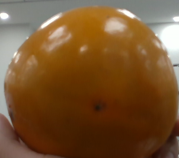
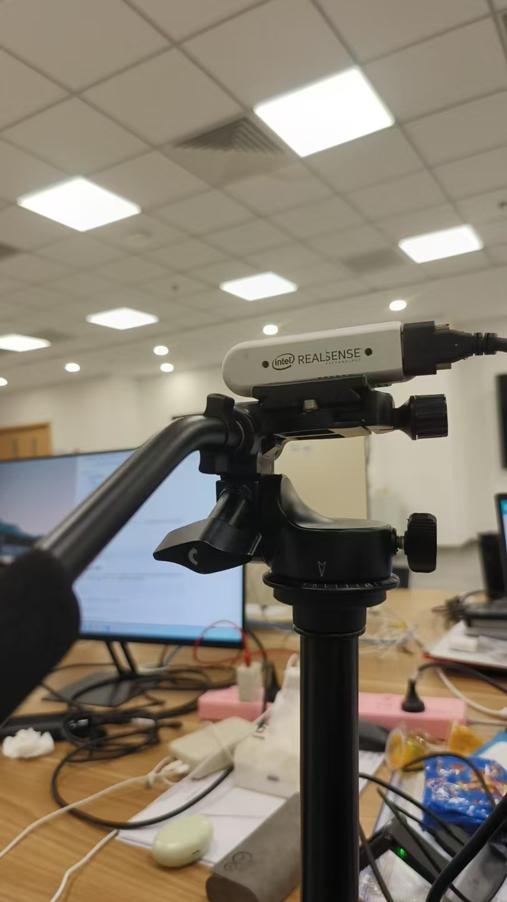

# PickGo Lab

v0.6.0 · 2026-10-28

D435 真实 RGB-D：同帧彩色图、配准深度图、点选测距及目标中心深度。选择“RealSense RGB-D / 真实测距”后打开，见 [使用与测量边界](docs/realsense-depth.md)。不自动保存照片或录像。

中文语音播报：支持试音、播报当前目标、自动播报及停止，见 [使用说明与实测边界](docs/speech.md)。TTS 不申请麦克风或调用云服务。

PickGo Lab 是一个轻量的底盘＋机械臂运动学仿真项目，同时提供复用原机器人代码的相机识别验证工具。

新增常见物体识别与前景分割：NanoDet COCO 80 类检测、检测框引导 GrabCut、手动框选 GrabCut。复用现有 OpenCV，模型约 3.8 MB，按需下载，无需 PyTorch。它是检测与传统前景提取的组合，尚不是训练好的实例分割网络。详见 [物体识别与分割](docs/objects.md)。

运动仿真可单文件离线运行；本机服务模式让网页、Python 动作函数和 MCP 共用一个机器人场景。视觉验证执行原 `det_color`、`det_rect` 和 HSV 配置。

支持连续帧位置检查、旧帧失效、框提示分割敏感性评估及不含图像的 JSON 记录，提供只读 MCP 工具 `assess_observation`。双击 `start-observation.cmd` 启动，按 [摄像头实操](docs/camera-validation-2026-10-24.md) 验证。新增观测功能无需额外权重；本机 NanoDet 校验通过时不必重复下载。

项目仓库：[williamtymhuabian/pickgo-lab](https://github.com/williamtymhuabian/pickgo-lab)。

## 演示与截图

### RGB 输入与送检帧



2026-10-18 从 D435 RGB 接口采集，按用户授权仅公开本地裁剪后的近景，未包含背景人员和电脑屏幕；拍摄后已释放相机。此图不表示目标识别或真实深度验收成功。



上图为本次使用的 D435 摄像头与三脚架实拍，展示实际安装状态。

下面两张是本轮页面联调截图。合成 RGB-D 图用于检查原视觉函数；视频输入使用浏览器合成测试流，画面标有 `SYNTHETIC TEST STREAM / NO HARDWARE`，没有打开真实摄像头，也不能据此判断 D435 的实物识别效果。


[摄像头实践与深度开发路线](docs/blog/README.md)：包含 D435、D405、D455 选型参考，以及拟新增的采集、坐标还原、区域测距、标定与回放模块。

### 离线运动演示

以下素材来自项目实际运行，展示运动学仿真与独立视觉验证；不连接真实机器人，视觉检测尚未接入自动搬运闭环。

### 完整搬运动画

红色方块从取物台出发，经过机械臂抓取、托盘固定、底盘绕障运输与投放，最终完成收臂和结果核验。录制时使用页面的 3× 播放速度，结尾任务状态为 `SUCCEEDED`。


[查看或下载清晰版 MP4（1280 × 960，约 19 秒）](docs/media/pick-and-deliver.mp4)

<details>
<summary>展开查看三维场景、托盘运输与视觉检测截图</summary>

### 三维仿真界面

取物台、投放台、障碍物与移动机械臂同场展示，右侧提供任务控制，底部显示实时位置与任务状态。


### 托盘固定与运输准备

红色方块已固定在车载托盘上，机械臂从托盘退出，接着收臂并沿规划路径运输。


### 原代码视觉验证

使用合成 RGB-D 测试图调用原 Python 识别函数，显示实际检测框、中心、角度与有效深度。截图中的检测耗时仅代表本次运行。


</details>

## 快速开始

### 只看运动仿真

用现代浏览器打开 `index.html`，不需要安装依赖。选择方块后点击“开始搬运”，即可演示抓取、托盘固定、绕障运输和投放。支持手动调姿、暂停、继续、停止和状态导出。

### 网页与 MCP 共用仿真

需要 Python 3.10+ 和 Node.js 18+，无 npm 依赖：

```bash
python -B app.py
```

打开 <http://127.0.0.1:8767/>。网页右上角显示“共享仿真 · MCP 可连接”。双击 `start.cmd` 也可启动。

MCP 客户端以 stdio 启动 `mcp_server.py` 即可；默认连接上面的本机服务，不会另建场景。配置示例见 [mcp.example.json](mcp.example.json)，把 Python 和脚本路径改为你电脑上的路径。详见 [MCP 接入说明](docs/mcp.md)。当前支持经典 MCP 协议的 stdio/tools 子集，不需要安装 MCP SDK。

可用工具：`get_capabilities`、`get_robot_state`、`grab_and_send`、`pause_task`、`resume_task`、`stop_task`、`reset_scene`、`det_color`、`detect_objects`、`assess_observation`。启动任务立即返回 `task_id`，随后查询状态；共享模式下网页关闭或 MCP 客户端退出，已接收任务仍由 `app.py` 执行。

### 可选：运行原代码视觉验证

在仓库目录运行：

```bash
python -m pip install -r requirements.txt
python -B app.py
```

已有依赖时可直接启动。未安装视觉依赖时，共享运动仿真和 MCP 动作工具照常可用，视觉工具会明确报告不可用。

打开：

- 运动仿真：<http://127.0.0.1:8767/>
- 视觉验证：<http://127.0.0.1:8767/vision.html>

服务仅监听本机，图像只在内存中处理；Ctrl+C 关闭。默认端口占用时可用 `python -B app.py --port 8768`，并改用对应端口访问。

视觉页面支持合成 RGB-D 测试图、位置与角度变化、颜色匹配、本地 RGB 图片、无目标和无效深度测试。输出检测框、中心、像素偏差、原始矩形角度与有效深度。

### 接入内置 / USB 摄像头进行 RGB 识别

```bash
python -B app.py --vision-only
```

Windows 可双击 `start-camera.cmd`。打开 <http://127.0.0.1:8767/vision.html?source=camera>，选择摄像头、点击“打开摄像头”，允许浏览器访问相机。支持单帧和连续颜色识别；此模式不需要 Node.js，不启动仿真进程。

普通浏览器摄像头模式选择 D435 名称以 RGB 结尾的接口，或内置 / USB 彩色摄像头；已知的 Depth / IR 接口会在列表中禁选。此模式只读取彩色画面，不需要 RealSense / OpenNI SDK。真实测距请使用下面的独立 RGB-D 入口。

检测框对应实际送检帧，实时预览独立显示；中心坐标以 320×240 送检图像为准。连续识别逐帧等待返回，不积压请求。可选择中心放大提高目标占比。原颜色算法包含 0.4 秒等待、颜色占比和轮廓尺寸门槛；常见物体识别使用下面的 NanoDet 模式。

只访问视频，不申请麦克风，不录制或保存摄像头图片。切换来源、关闭摄像头或退出页面会释放设备。若内嵌浏览器无法授权，请在本机 Edge / Chrome 打开同一地址。详细排查见 [摄像头说明](docs/camera.md)。

### 识别常见物体与提取前景

已有视觉依赖时运行：

```bash
python -B setup_objects.py
python -B app.py --vision-only
```

打开 <http://127.0.0.1:8767/vision.html?task=objects>，选择“常见物体检测”或“物体检测＋前景分割”，再选择本地图片或手动打开 RGB 摄像头。也可选择“手动框选前景分割”，冻结一帧后拖动框选，这个模式不需要下载模型。检测与分割不启动搬运。详见 [使用说明与限制](docs/objects.md)。

### D435 彩色 / 深度同帧显示与测距

先准备可选 RealSense SDK，再启动本机服务：

```powershell
python -B -m pip install --no-deps --only-binary=:all: --index-url https://pypi.org/simple --target .runtime/realsense -r requirements-depth.txt
python -B app.py --vision-only
```

打开 <http://127.0.0.1:8767/vision.html?source=realsense&task=objects>，点击“打开摄像头”。物体识别还需先运行 `python -B setup_objects.py`。页面同时显示彩色送检图和已配准的深度伪彩图；点击图像或目标可查看该帧对应位置的光轴深度 Z。无效、混合或过期深度不显示距离。

真实 D435 已完成采集、配准、页面显示和点选测距连通验证；未做尺具精度标定，金属保温杯表面可能缺深度。完整安装、测量定义与限制见 [RGB-D 说明](docs/realsense-depth.md)。普通 RGB 模式不需要此 SDK。

### 中文播报识别结果

在视觉页面点击“试音”或“播报当前结果”；勾选“自动播报识别结果”并连续识别，可限频播报类别。“停止播报”同时关闭自动播报。Windows 使用本机中文语音，其他平台可使用浏览器已有的本地中文语音，不调用云服务。详见 [TTS 说明](docs/speech.md)。

## 目录

```text
index.html                 单文件三维运动仿真
vision.html                相机输入与原代码识别验证
simulator-core.js          独立运动学、寻路和任务状态机
simulator-worker.cjs        网页与 MCP 共享的仿真进程
Constants.py               APP / ROBOT / GRAB 配置字典
utils.py                   业务函数及工具名称映射
robot.py                   底层仿真通信函数
app.py                     本机网页与 HTTP 接口
mcp_server.py              MCP stdio 入口
mcp.example.json           客户端配置示例
legacy_vision.py           原识别函数加载与图像/深度适配
object_vision.py           NanoDet 物体检测与 GrabCut 前景分割，函数式入口
observation_quality.py     同帧框扰动分割敏感性评估，不需要权重
observation_state.js       新鲜帧检查与独立运动学对照
observation_ui.js          观测建议、人工复核与无图 JSON 报告
setup_objects.py           可选小模型下载、固定版本与 SHA256 校验
download-weights.cmd       按需准备物体识别模型
start-observation.cmd      启动观测验证，不自动打开摄像头
vision_helpers.js          掩膜透明度与显示/图像坐标转换
models/                    模型说明与许可证；本机 ONNX 被 Git 忽略
camera.js                  本机视频采集、设备选择、中心裁剪与资源释放
realsense_camera.py        可选 D435 SDK 采集、配准、同帧测距与释放
depth_client.js            RGB-D 页面会话、帧号及点选测距
speech_audio.py            Windows 本地中文语音，在内存中生成音频
vision_speech.js           中文类别映射、播放、去重和限频
requirements-depth.txt     可选 RealSense 运行库固定版本
start-camera.cmd           仅启动摄像头识别（不需要 Node.js）
start.cmd                  Windows 启动脚本
requirements.txt           可选视觉功能依赖
legacy/
  utils.py                 用户提供的原模块，逐字节保留
  source-manifest.json     原文件来源与 SHA256
tests/                     运动仿真与视觉接口测试
docs/
  usage.md                 详细操作说明
  architecture.md          后续通用机器人平台设计草案
  mcp.md                   MCP 接入、函数入口与协议边界
  camera.md                RGB 摄像头操作、实测记录与排查
  objects.md               物体识别、框选分割、模型准备与 MCP
  roadmap.md               创新方向与后续实现路线
  github.md                GitHub 上传说明
experiments/
  reachability-probe.cjs    固定停车位的可达性探测
CHANGELOG.md               更新记录
NOTICE.md                  原代码来源与许可说明
examples/pick_and_send.py   按步骤调用业务函数的示例
```

克隆后的运行与测试不依赖仓库外的原始工程。原生 SDK、ROS 工程、历史备份、录制数据和大型二进制不包含在这个轻量仓库中。

## 代码来源与当前能力

新编写：浏览器渲染、简化四轴机械臂与差速底盘模型、正逆运动学、底盘 A* 寻路、任务状态机、界面、视觉适配与本机服务。

控制代码沿用原项目的组织习惯：`Constants.py` 放字典配置，`utils.py` 放 `all_init`、`grab_and_send` 等动作函数，按工具名称查字典后调用明确的函数。`robot.py` 隔离通信，`app.py` 和 `mcp_server.py` 共用这些入口。底层数学核心保留独立状态对象，HTTP 处理器使用标准库要求的类；不会为了外观一致修改已验证的原算法。

复用：`legacy/utils.py` 中的 `det_color`、`det_rect` 和 `col_dict_daylight_shelf_1`。只按 AST 白名单加载所需定义，不导入整个原模块，不触发 ROS、串口或机器人初始化。页面显示原文件 SHA256 与函数行号；测试校验原文件内容未变。原始文件的来源与归属沿用源项目，没有给原始代码或厂家 SDK 另行声明许可证。

当前视觉页面支持真实 RGB 摄像头、本地图片、可控二维 RGB-D 测试图及 D435 配准 RGB-D，提供颜色检测、常见物体检测、框提示前景提取、点选测距和中文播报。深度为相机光轴 Z，不是机械臂坐标或抓取位姿；自动搬运仍采用简化几何位置，尚未由视觉检测结果闭环驱动。运动模型不计算抓取力、摩擦或惯性，也没有完整机械臂碰撞检测。

## 测试

已验证环境：Python 3.11.7、NumPy 1.26.4、OpenCV 4.11.0.86。运动核心测试只使用 Node.js 内置模块，无 npm 依赖。

```bash
python -B -m unittest discover -s tests -p 'test_*.py'
node --test tests/*.test.cjs
```

原有 27 项测试覆盖正逆运动学、三种目标搬运、底盘避障与互锁、暂停取消、颜色/中心/角度、有效深度、原文件完整性、本机 HTTP、MCP stdio 协议和网页/MCP 共用状态。另有 8 项摄像头辅助模块测试，覆盖权限取消、超时、设备释放、断开、画面缩放与 RealSense 接口区分。摄像头模块测试使用假视频流，不代表真实设备已完成识别验收。

v0.4.0 增加物体/分割后端测试和前端图像辅助断言。公开图片已验证人物和足球检测、前景掩膜与手动框选；10 月 24 日又完成真实 D435 画面上的识别与分割连通测试，记录见 [RGB 实测](docs/camera-smoke-test-2026-10-24.md)。

v0.5.0 增加 11 项观测评估后端检查与 16 项观测状态/运动学/报告检查，覆盖重复视频帧、证据过期、累计漂移、同帧自适应预算、空前景、HTTP / MCP 只读入口和下载清单。页面已用合成图验证三次/五次评估，摄像头未在本次开发中打开。分割一致性不是准确率；运动学示例与相机没有空间绑定。

2026-10-28 同步版本完整 Python 回归 66 项通过，全部 JavaScript 测试通过，并保留线上已有的取消请求回归。自动测试使用假相机，不自动打开硬件；真实设备采集、点选和播报验证另见 [RGB-D](docs/realsense-depth.md) 与 [语音实测](docs/speech.md)。历史 v0.5.0 记录见 [验证记录](docs/validation-2026-10-23.md)。

详细说明见 [操作说明](docs/usage.md)，后续硬件与平台方案见 [架构草案](docs/architecture.md)。

## 在博客中分享

- 展示仿真：可将 `index.html` 放在支持静态 HTML 和 JavaScript 的托管位置，作为独立页面链接或在博客中嵌入。它不需要服务端程序。
- 分享完整项目：上传完整源码压缩包，读者解压后可查看文档，并在本地运行。
- 原 Python 视觉识别需要运行 `app.py`；单纯把页面放到静态博客，不能执行 Python/OpenCV。视觉页面会显示服务未连接，不会伪造检测结果。博客演示可注明“运动仿真在线体验，原代码视觉验证下载后本地运行”。
- MCP 和共享仿真同样需要本地程序；静态博客展示的是独立离线运动演示。

压缩包不包含 Git 元数据、Python 环境、临时图片、厂家 SDK 或原始控制工程的大型二进制。

## 项目状态与开发

本版包含离线运动仿真、本机共享控制和 RGB / RGB-D 视觉验证。D435 实机采集、配准、点测距及中文播报已经连通；金属保温杯仍有 cup/bottle 混淆、漏检和深度空洞，不能据此宣称稳定识别或测量精度。视觉控制闭环、手眼标定及实体机器人驱动尚未完成；暂停的 OpenNI 原型不包含在本上传版中。

更新记录见 [CHANGELOG](CHANGELOG.md)，创新方案见 [后续路线](docs/roadmap.md)，下一次研究与实操安排见 [2026-10-19 实验计划](docs/plan-2026-10-19.md)，可复现实验见 `experiments/reachability-probe.cjs`，上传说明见 [GitHub](docs/github.md)。原代码来源及许可状态见 [NOTICE](NOTICE.md)。

## AI 协作致谢

感谢 OpenAI ChatGPT / Codex 在项目整理与发布过程中的协助，包括代码阅读、运行与测试验证、项目文档和博客文章撰写，以及 Git/GitHub 发布流程。

本项目由 Williamtym 维护，功能方向、内容审核与发布决定由维护者负责。这里记录 AI 工具的协作贡献；原有代码的来源与归属仍以“代码来源与当前能力”一节为准。
