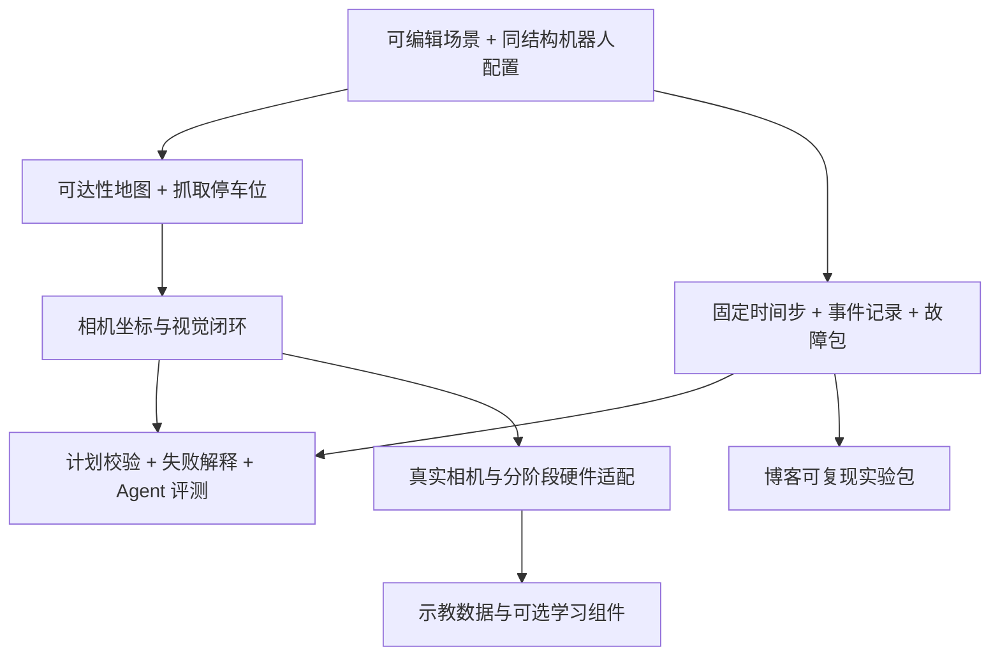

# PickGo Lab：创新方向与落地路线

分析日期：2026-10-18。范围：现有源码、一个针对固定停车位的运动学实验，以及下方列出的公开项目文档。本文件是方案，不表示这些功能已经实现；本次没有修改机器人运行代码或原始视觉算法。

## 核心判断

建议把 PickGo Lab 定位为：**帮助个人开发者在造机器人之前验证结构，在执行任务之前验证计划，在任务失败之后找到原因的轻量移动操作实验室。**

最值得组合的三条主线：参数化机器人设计、底盘与机械臂的抓取可达性、可复现的任务评测。视觉闭环将它们连接到真实输入，MCP 将它们连接到不同的 AI 客户端。

创新价值主要在组合方式、使用门槛和验证体验。这里没有证据支持“全球首创”“已有系统都做不到”或论文级原创性判断。移动机械臂、示教学习、分阶段任务规划本身已有公开实践：LeRobot/LeKiwi 提供移动机器人及示教流程，MoveIt Task Constructor 提供分阶段抓取规划。可以借鉴它们的边界和接口，逐步形成适合这个小项目的特色。[LeKiwi](https://huggingface.co/docs/lerobot/lekiwi)、[LeRobot](https://huggingface.co/docs/lerobot/index)、[MoveIt 抓放教程](https://moveit.picknik.ai/main/doc/tutorials/pick_and_place_with_moveit_task_constructor/pick_and_place_with_moveit_task_constructor.html)

## 当前资产与真实缺口

已经有：无第三方前端库的浏览器运动仿真、正逆运动学、底盘 A*、明确的抓放步骤、托盘运输互锁、原颜色算法适配、Python/网页/MCP 共用状态、27 项现有测试。这个基础很适合增加小而可验证的能力。

需要区分的五个事实：

1. [simulator-core.js](../simulator-core.js) 的 CONFIG、LIMITS、STOW、障碍物和流程仍由模块内常量决定。Constants.py 中的 ROBOT 字典还不能生成不同尺寸或不同自由度的机械臂。
2. start() 直接读取物体的几何真值，取物停车点的 y 固定为 0.32 m，投放点和停车点也内置在流程中。当前成功说明示例场景可执行，尚未证明对物体位置变化有适应能力。
3. [legacy_vision.py](../legacy_vision.py) 的识别与运动控制尚未闭环连接；视觉测试图也不是三维场景相机的成像结果。
4. snapshot() 没有记录完整控制器内部状态、活动阶段的进度和全部时间步。现有步骤队列还包含函数闭包。导出 JSON 可以查看状态，不能直接拿来从任意时刻恢复并重演。
5. [utils.py](../utils.py) 的 MCP 工具封装了状态和固定搬运流程。还没有可预览的任务计划、场景版本绑定、幂等请求、任务所有权或跨机器人能力匹配。

这些缺口就是下一步机会；不需要同时引入大型物理引擎、训练模型或机器人中间件。

## 一个实际探测：目标挪动 10 cm 后会怎样

使用同一份当前运动核心，每次创建全新 Simulation；仅改变红色方块 y，x、高度、障碍物和动作程序均保持不变；固定时间步 0.04 s。复现命令：

```text
node experiments/reachability-probe.cjs
```

- y=0.76 m：SUCCEEDED，仿真时间 48.68 s。
- y=0.86、0.96、1.06、1.16 m：均在仿真时间 8.16 s 进入 FAILED，原因为 OUT_OF_REACH。

这是五个确定输入的探测，不能当作随机成功率，也不是实体机器人的性能。它说明当前程序对固定布局有依赖，尤其预抓取位同样需要满足可达性。可行停车点还受桌子与底盘间隙限制，因此“多向前开一点”并不总能解决问题。

这一结果支持把“抓取停车位规划”和“执行前说明失败原因”作为主打功能。

## 方向一：造机器人之前就能用的设计助手

用户体验：填写臂长、安装高度、关节范围、底盘尺寸与桌面高度，看到机器人能抓的区域、必须停车的区域和无论如何都够不到的位置。比较两个参数方案时能看到它们解决了哪些任务。

与当前基础的连接：正逆解和底盘碰撞检测已存在；先把几何参数从封闭常量变成验证后的 robot_profile，再让场景、渲染器和控制器读同一份配置。

第一版只支持当前机械臂结构族的参数变化。任意四轴结构或换成六轴，必须匹配新的运动学模型；不能只更改 axes 数字。先提供 reachability_map 与 check_task_geometry，输入结构配置与任务工位，输出可达、不可达及失败阶段。

验收：修改一项臂长后，渲染与运动学一致；对可达点做 FK/IK 检验；不可达的预抓取位在启动前被报告；不支持的关节拓扑明确拒绝。

特色：把博客上的演示变成读者设计自己小机器人的工具。几何可达性不能替代载荷、扭矩、结构刚度或防倾覆验证；这些应在后续加入质量与实测参数后分开评估。

## 方向二：让底盘主动为机械臂选择抓取位置

用户体验：移动方块后，机器人重新选择合适的停车位置与朝向；选不到时，画出被排除的位置并说明“底盘间隙不足”“预抓取位不可达”或“关节限位”。

第一版实现：在目标附近采样底盘候选位置与朝向，依次检查底盘通路、停车间隙、预抓取/抓取/抬升/托盘各阶段的逆解。对有效候选按路径长度、关节余量、障碍间隙排序；评分先用明确规则，不需要学习模型。

验证必须覆盖整条动作链。单个目标点 IK 成功不意味着接近路径和托盘动作可执行。起步仍保持“底盘移动时收臂，机械臂动作时停车”；后续需要完整碰撞检测后再考虑更复杂的协同运动。

Nav2 的 docking 流程区分前往 staging pose 与最终对接，可以借鉴“粗到位→精对位”的分工；抓取停车点仍需要我们自己的可达性约束。[Nav2 Docking](https://docs.nav2.org/jazzy/tutorials/general_tutorials/using_docking/)

验收：在明确定义的一组变动场景里，对确实存在可行解的任务选出停车位；对不存在解的任务提前拒绝，并能给出具体失败约束。记录规划耗时和成功条件，不只展示一条好看的路径。

## 方向三：从独立识别页面走到真实的视觉闭环

用户体验：机器人依据相机观察寻找方块，目标变动后重新观察和对位；缺少深度、目标被挡住或标定失效时停止并说明原因。

建议分三步：

1. 为三维场景增加独立的相机坐标系、内参和图像/深度生成。使用简化几何投影和深度遮挡即可，不追求照片真实感。
2. 原 det_color/det_rect 只接收图像；经过有效深度、内外参、时间戳和坐标转换得到抓取估计。控制器只读估计值，几何真值保留给评测器算误差。
3. 加入拍照→小步修正→复查的闭环，最后接真实相机。第一版可用带已知尺寸标记的固定工位，减少场景未知量。

OpenCV 的 ArUco 文档包含检测与姿态估计的技术基础。标记的实际尺寸、相机标定和坐标系约定仍必须正确；贴码本身不会自动获得可靠的机械臂坐标。[OpenCV ArUco](https://docs.opencv.org/4.x/d5/dae/tutorial_aruco_detection.html)

验收：移动或遮挡目标能影响控制；缺失深度不补造位置；分别记录像素误差、三维估计误差、最终抓取偏差。用几何真值直接下发抓取时，界面必须仍标注为几何模式。

## 方向四：专门测试机器人如何失败、如何恢复

用户体验：勾选“目标在接近时挪动”“深度失效”“到位有偏差”“抓取结果未确认”“路径被挡住”，看机器人是重新观察、重新选停车位、保持持物还是请求帮助。

这是很适合本项目的特色：场景小、状态机明确，能把失败条件展示清楚。恢复策略首先按失败类别显式编写；例如未抓到物体可以重新观察，持物不明则保留当前位置并等待确认，不能统一重跑整段任务。

需要一个可复现实验包：场景、模型版本、随机种子、初始条件、按固定步数触发的故障、命令序列、预期后置条件。随机种子本身不足以保证重现，还需要固定时间步和确定的事件顺序。

第一版做 JSONL 事件记录与从起点重跑。任意时刻断点续演需要把队列中的闭包改成可序列化阶段描述，并保存控制器状态。仿真中的命令重放不得直接复用成实体设备的自动重试。

验收：同版本、同场景、同输入产生一致的终态与事件摘要；报告区分“正确拒绝”“错误执行”“成功完成”和“请求接管”。故障种类与分布必须随结果一同公布。

## 方向五：让 MCP 成为可检查的机器人任务接口

用户体验：AI 客户端能回答“这台机器人为什么做不了”“可以换什么停车位置”“执行前需要哪项观测”，并给出可在网页里预览的计划。

建议新增的工具名称均为方案，尚未实现：

- inspect_scene：查询带时间戳、来源与不确定性说明的场景估计。
- plan_task：生成目标、动作阶段、前置条件、后置条件和拒绝理由。
- validate_plan：针对当前模型、标定与场景版本检查计划。
- execute_plan：仅执行仍有效的计划，并返回独立 task_id。
- explain_failure：从结构化失败码和观测证据解释原因。

计划应绑定模型版本、标定版本、场景版本与有效期。执行时及关键阶段重新检查条件；规划预览不能证明之后场景不变。加入幂等请求标识和控制权规则，防止多个入口重复启动或误操作别人的任务。

已有固定状态机先提供执行保证，语言模型负责组合目标、解释和选择受限技能。评价不同 AI 客户端时，给它们同一组场景与故障，比较正确完成、正确拒绝、额外动作与调用成本，形成轻量的机器人 Agent 评测。

MCP 适配是接口基础；创新来自“计划有依据、失败能解释、任务可评测”的体验，而不取决于工具数量。

## 方向六：把技能、场景和证据做成可分享的任务包

用户体验：博客分享一个整理小物品的实验，读者导入同一个任务包，可以修改参数、运行并比较结果，找到是什么配置差异导致失败。

任务包包含 scene.json、robot_profile.json、mission.json、seed、预期条件、版本号和摘要哈希。任务流程采用声明式步骤与已有技能白名单，不在分享包里运行任意 Python/JavaScript。

可以逐步做颜色分拣、工具配送、收纳盒补货、固定工位样品转运。实验必须说明物体与工位假设，先使用已支持的物品，不把按钮改名后的同一段动画算成新技能。

静态博客运行离线演示，原 Python 视觉与 MCP 继续在本机程序运行。分享 JSON 导入本机即可；保持当前 Origin 校验，不为了博客远程调用而随意开放本机控制接口。

验收：任务包不包含环境安装、视频或 SDK 时能保持小体积；不支持的能力和模型版本明确报错。包大小随实际打包结果公布，不预先承诺固定大小。

## 方向七：逐步替换为真实设备的实验台

用户体验：先让真实相机观察虚拟任务，再接单独机械臂，之后把底盘加入同一套实验。每一步都可看出仿真与设备观测的偏差。

建议顺序：真实图像只读接入→标定与虚拟抓取验证→单独机械臂执行已验证动作→底盘里程计只读对比→整机工位任务。让用户选择明确的 sim/只读观测/硬件执行模式，记录观测时间和设备状态。

同名函数可以保留上层调用习惯，但设备驱动的单位、自由度、命令完成回执、限位、急停与标定必须单独实现。当前 robot.py 只有 sim；新增 backend 名称不会自动完成硬件适配。

验收：混合模式不向未授权设备发运动命令；预期结果与实测结果分开记录；有过期观测或状态未知时拒绝继续依赖该状态的动作。实体闭环需要新的台架验证，仿真测试不能替代。

## 方向八：先采示教经验，再考虑学习新技能

用户体验：用户在虚拟场景中演示一次对位或放置，系统保存经过哪些中间位、在哪个阶段失败，随后重复或辅助修正。

第一步做固定工位的关键帧与动作片段录制、参数化回放、适用条件校验；这属于示教与轨迹复用，不应宣称“演示一次即可学会任意抓取”。

后续对齐真实机器人的关节、频率、相机和动作语义后，再做示教数据导出，选择性接入 LeRobot 的录制与模仿学习流程。现有 JSON 快照并不自动等价于 LeRobotDataset。[LeRobot 工作流与数据接口](https://huggingface.co/docs/lerobot/index)

数据采集与训练依赖可做独立可选组件。主程序仍只负责记录少量状态、关键观测和任务事件，视频、训练环境和模型权重默认不随项目分发。

## 怎样保持轻量

把数据分成必需的配置/事件、可选的图像片段、外部模型/运行环境三层。优先采用几何模型、JSON 配置、已有 OpenCV 和无界面仿真；大型物理引擎或学习模型未来可作为独立后端选择。

一个体积量级对比，下面是算术估算，不是当前系统的性能测试：

- 每帧 20 个 float64 数值、10 Hz、记录 60 秒，纯数值部分为 20×8×10×60=96,000 字节，另有 JSON、时间戳和事件开销。
- 640×480 RGB、30 fps、60 秒、不压缩为 640×480×3×30×60=1,658,880,000 字节；编码后的体积取决于内容与编码参数。

因此优先记录配置、命令、必要的状态与短关键帧；视频按需录制。不能把当前约 80 KB 源码压缩包大小推导成包含视频、模型或 Python/Node 的安装体积。

## 推荐实施顺序



建议下一版的具体主题：**“我的小机器人够不够得着？”**

先让用户改变目标位置、桌高和同结构臂长，得到可达性图与执行前检查；随后让系统选择停车位。它直接回应“以后自己造小机器人”，视觉效果清楚，主要复用现有数学核心，也为后面的闭环与评测提供必要基础。

实现基础时同步加入事件记录与固定时间步，避免之后补做失败复现。视觉闭环是第二个大阶段；MCP 计划和解释工具再基于这些真实证据构建。

优先级是结合用户目标的工程判断，不是测量得出的评分；不在缺少设备、任务范围与投入时间的情况下承诺工期。

暂缓：通用任意物体抓取、同时移动底盘和展开机械臂、任意自由度模型生成、完整家居无人值守、大模型本地训练。这些方向需要当前没有的感知、碰撞、动力学或实体设备基础。可保留接口扩展点，先完成能验证的完整任务。

## 可以形成的项目特色

对个人造机器人：先验证结构与工位，再选硬件与标定。

对 AI 开发者：用同一组小场景与故障检查 Agent 的完成、拒绝与恢复能力。

对博客读者：得到可以复现实验、修改参数、看懂失败原因的任务包。

这三个用户群共享同一个轻量核心，投入能相互复用，比彼此独立添加大量功能更适合 PickGo Lab 当前规模。
